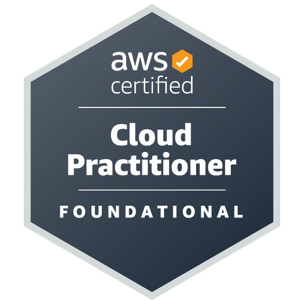
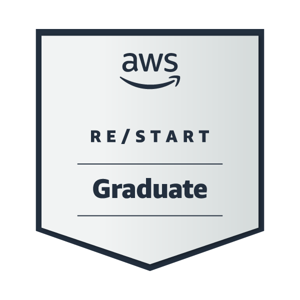

<h2 align="left">Hi, I'm Ryan 👋</h2>

DevOps & Cloud intern at **Hydro Energia (Norsk Hydro)** and Software Engineering student at the State University of Pará (UEPA), in Belém, Brazil. I'm also a LINUXtips.local ambassador and help organize DevOpsDays Belém.

<h3>🔧 What I work with</h3>

- **Cloud:** Azure (Data Factory, Databricks, Azure Virtual Desktop) · AWS
- **IaC and CI/CD:** Terraform · Gitea Actions · GitLab CI · Git
- **Containers:** Docker · Docker Swarm · Traefik
- **Observability:** Prometheus · Loki · Grafana
- **Data and languages:** Python · SQL · Power BI
- **Practices:** DevOps · FinOps · Zero Trust · medallion architecture

<h3>📌 Highlights</h3>

- 🏆 **Top 3, Energia Improvement Projects Prize 2026 (Hydro):** *Azure Cost Optimization*, a FinOps project with shift-left and frugal architecture that cut the monthly Azure cost by about 70%.
- 🐳 **[DevOps API Flask](https://github.com/theunrealryan/devops-api-flask):** self-hosted CI/CD on Gitea Actions, rolling updates on Docker Swarm, Traefik with TLS, and observability with Prometheus, Loki and Grafana.
- 🚪 **[Doorman](https://github.com/jhermesn/doorman):** group project with Jorge Hermes and Yasmim Moraes for Fly.io Hacksgiving 2026, an open source AI agent that only accepts bug reports and pull requests it can reproduce.
- 📄 **[Memory cost in Cloud Native](https://github.com/theunrealryan/artigo-compiladores-devops):** coursework for Compilers and Interpreters at UEPA, a C vs Python benchmark and its effect on OOMKilled in Kubernetes.

<h3>🏅 Certifications</h3>

<h3>📫 Contact</h3>

